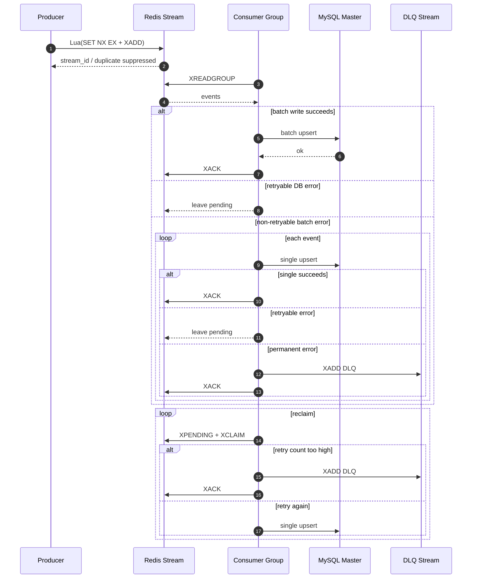

# Redis Stream + MySQL 金融日志高可靠最终一致性 Demo

这个仓库实现的是一个面向金融审计/交易日志旁路入库场景的高可靠最终一致性 demo：

- 主业务链路与日志落库链路解耦
- 生产者把日志事件原子写入 Redis Stream
- 消费者用 Consumer Group 做批量拉取、幂等落库和失败恢复
- MySQL 作为最终审计存储
- Redis DLQ 用来隔离永久失败消息，并支持后续 replay

目标不是强一致事务日志，而是：

- 在高并发场景下避免日志旁路入库成为主交易瓶颈
- 通过 `at-least-once + 幂等落库 + reclaim + DLQ + replay` 保障日志最终可达
- 在工程复杂度可控的前提下，把“不丢、可恢复、可对账”放在优先级前面

## 1. 可靠性语义

### 交付语义

- 本方案的目标语义是 `eventual consistency`
- Redis Stream 消费侧采用 `at-least-once`
- MySQL 落库通过业务主键 `event_id` 做幂等收敛
- ACK 只会在以下两种情况下发生：
  - 事件已经成功写入 MySQL
  - 事件已经被成功转移到 DLQ

这意味着：

- 数据库瞬时失败时，消息会继续留在 PEL，等待后续 reclaim
- ACK 失败时最多造成重复投递，不会造成静默丢失
- 重复投递会被 `ON DUPLICATE KEY UPDATE` 安全吸收

它不提供“主业务提交成功时日志已同步落入 MySQL”的强一致保证；它提供的是“主业务成功后，日志最终会被可靠补齐到审计库”的工程保证。

### 生产端幂等

生产者使用 Lua 在 Redis 内完成：

1. `SET NX EX` 写入去重键
2. `XADD` 写入 Stream

两步在同一个 Lua 脚本中执行，避免“去重标记成功但消息没入流”或“消息已入流但去重状态缺失”的中间态。

### 消费端失败处理

- 批量落库成功：批量 `XACK`
- 批量落库遇到可重试错误：不 ACK，消息保持 pending
- 批量落库遇到不可重试错误：降级为单条处理
- 单条处理成功：`XACK`
- 单条处理为可重试错误：不 ACK，等待 reclaim
- 单条处理为不可重试错误：写入 DLQ 后 `XACK`

### Pending reclaim

后台 reclaim worker 周期性扫描超过 `MinIdle` 的 pending 消息：

- 使用 `XPENDING` 获取真实投递次数
- 使用 `XCLAIM` 把超时消息转移到当前消费者
- 超过 `MaxDeliveries` 的消息直接转入 DLQ
- 未超过上限的消息重新按单条流程处理

这保证了消费者宕机、重启或 flush 期间异常退出时，消息仍然能被后续节点接管。

### DLQ replay

DLQ 不是终点。对于因为脏数据、临时 bug 或下游修复前失败的日志，可以在修复完成后执行 replay，把 DLQ 中的事件重新写回主 Stream。

本仓库提供了单独的 replay 工具：

```bash
go run ./cmd/replaydlq
```

可选参数：

- `DLQ_REPLAY_COUNT`：单次最多 replay 多少条，默认 `100`
- `DLQ_REPLAY_KEEP_SOURCE`：是否保留原始 DLQ 记录，默认 `false`

## 2. 当前架构

```text
.
├── cmd/
│   ├── consumer/main.go
│   └── producer/main.go
│   └── replaydlq/main.go
├── internal/
│   ├── config/
│   │   └── config.go
│   ├── consumer/
│   │   ├── service.go
│   │   └── service_test.go
│   ├── dbx/
│   │   ├── middleware.go
│   │   └── mysql.go
│   ├── logger/
│   │   └── logger.go
│   ├── model/
│   │   └── event.go
│   └── redisx/
│       ├── client.go
│       └── scripts.go
├── docker-compose.yml
└── README.md
```

职责划分：

- `cmd/*`：进程装配与生命周期管理
- `internal/config`：环境变量配置加载
- `internal/model`：Stream 事件模型与解析
- `internal/consumer`：消费、flush、reclaim、DLQ 状态机
- `internal/dbx`：MySQL 连接池、建表、批量幂等落库
- `internal/redisx`：Redis 客户端与生产端 Lua 脚本
- `cmd/replaydlq`：DLQ 回灌工具

## 3. 数据流



## 4. 它为什么更适合金融日志旁路

这套方案最适合的不是“资金余额强一致更新”，而是：

- 交易审计日志
- 风控流水
- 操作留痕
- 对账辅助事件

原因是它把关键目标放在了下面这几个能力上：

- 主交易链路不被日志落库阻塞
- 日志链路在高峰期可削峰、可排队
- 出现故障后可以继续补偿，不依赖人工从零找回
- 通过幂等主键和 replay 机制避免重复入库污染审计表

如果你要承诺更强的“不丢”语义，建议继续补这几层：

1. Redis 提升为更严格的持久化与副本确认策略
2. 增加业务流水与审计表之间的对账任务
3. 为 replay 增加审批、批次号和操作审计
4. 为 producer 增加入口级限流和背压控制

## 5. MySQL 表设计

消费者启动时会自动创建表：

```sql
CREATE TABLE IF NOT EXISTS audit_logs (
    event_id VARCHAR(100) PRIMARY KEY,
    stream_id VARCHAR(100) NOT NULL,
    session_id VARCHAR(100) NOT NULL,
    payload TEXT NOT NULL,
    produced_at TIMESTAMP NOT NULL,
    created_at TIMESTAMP DEFAULT CURRENT_TIMESTAMP,
    updated_at TIMESTAMP DEFAULT CURRENT_TIMESTAMP ON UPDATE CURRENT_TIMESTAMP,
    KEY idx_audit_logs_session_id (session_id),
    KEY idx_audit_logs_created_at (created_at)
);
```

说明：

- `event_id` 是幂等主键
- `stream_id` 保留 Stream 侧观测信息，便于排障
- `payload` 保存原始消息体

## 6. 配置项

### Redis / Stream

- `REDIS_HOST`，默认 `localhost`
- `REDIS_PORT`，默认 `6379`
- `STREAM_NAME`，默认 `event_queue`
- `STREAM_GROUP`，默认 `processor_group`
- `DLQ_STREAM`，默认 `event_queue_dlq`

### Producer

- `PRODUCER_WORKERS`，默认 `20`
- `PRODUCER_INTERVAL`，默认 `10ms`
- `PRODUCER_DEDUPE_TTL`，默认 `5m`

### Consumer

- `CONSUMER_NAME`，默认 `consumer-node-1`
- `BATCH_SIZE`，默认 `500`
- `FLUSH_INTERVAL`，默认 `1s`
- `READ_COUNT`，默认 `100`
- `READ_BLOCK`，默认 `2s`
- `RECLAIM_INTERVAL`，默认 `5s`
- `RECLAIM_MIN_IDLE`，默认 `10s`
- `RECLAIM_COUNT`，默认 `100`
- `MAX_DELIVERIES`，默认 `5`
- `DB_TIMEOUT`，默认 `3s`
- `SHUTDOWN_FLUSH_TIMEOUT`，默认 `10s`

### MySQL

- `MYSQL_MASTER_DSN`
- `MYSQL_SLAVE_DSN`

默认值：

- `root:root_pass@tcp(localhost:3306)/audit_log?parseTime=true`
- `root:root_pass@tcp(localhost:3307)/audit_log?parseTime=true`

## 7. 本地启动

如果你在国内网络环境，建议先设置 Go 代理：

```bash
go env -w GOPROXY=https://goproxy.cn,direct
```

这个仓库的 `Dockerfile` 和 `docker-compose.yml` 也已经默认使用：

```text
https://goproxy.cn,direct
```

如果你想临时切换成别的代理，可以在启动 Compose 时覆盖：

```bash
GOPROXY=https://goproxy.io,direct docker compose up --build
```

```bash
docker compose up --build
```

Compose 做了几件事：

- 启动 Redis，并开启 AOF `appendfsync everysec`
- 启动 MariaDB 主从
- 启动 1 个生产者和 2 个消费者
- 通过 healthcheck 等待 Redis / MySQL 就绪后再拉起业务进程

### 监控入口

拉起后可以直接打开：

- Grafana: `http://localhost:3000`
- Prometheus: `http://localhost:9090`

Grafana 默认账号：

- 用户名：`admin`
- 密码：`admin`

Grafana 会自动加载 `Redis MQ Overview` 仪表盘，不需要手动配数据源。

### 当前已暴露的指标

- 生产速率：`redismq_producer_published_total`
- 生产失败数：`redismq_producer_publish_failed_total`
- 去重抑制数：`redismq_producer_duplicate_suppressed_total`
- 消费事件结果：`redismq_consumer_events_handled_total`
- 批量 flush 结果：`redismq_consumer_batch_flush_total`
- DLQ 进入量：`redismq_consumer_dlq_total`
- reclaim 活动：`redismq_consumer_reclaim_total`
- poll 错误数：`redismq_consumer_poll_errors_total`
- 内存 buffer 大小：`redismq_consumer_buffer_size`
- 最近一次 reclaim 认领数：`redismq_consumer_pending_claimed`
- 批大小分布：`redismq_consumer_batch_size`
- DB 写入延迟：`redismq_consumer_db_write_seconds`

## 8. 关键实现决策

### 为什么 ACK 放在 DB 成功之后

这是整个链路最核心的约束。只要在持久化之前 ACK，就会在进程崩溃、数据库超时或网络闪断时造成不可恢复的数据丢失。

### 为什么批量失败后要降级成单条

批量写库更高效，但一旦整批失败，我们需要区分：

- 只是数据库暂时不可用
- 还是某条消息本身不可处理

降级到单条后，才能把真正的坏消息隔离到 DLQ，而不拖住整批正常消息。

### 为什么 reclaim 走单条重放

reclaim 的目标是恢复正确性，不是追求峰值吞吐。超时消息通常意味着消费者曾经异常退出、数据库波动或消息本身存在问题，此时单条重放更容易控制风险和记录原因。

## 9. 当前边界

这个仓库已经具备金融日志高可靠最终一致性的最小闭环，但仍有明确边界：

- 已有 Prometheus 与 Grafana 面板，但还没有告警规则
- DLQ 已支持 replay，但还没有审批流、批次号和操作留痕
- 没有做分库分表、跨机房容灾、限流熔断
- 没有做集成测试与压测基准
- 生产者示例目前是演示流量，不是业务 API

如果你要继续往线上化推进，下一步最值得补的是：

1. 告警规则：DLQ 激增、DB 延迟升高、持续 reclaim
2. 对账任务：按业务流水核对 Redis 事件数、DB 落库数、DLQ 数
3. 集成测试：容器内验证重复投递、DB 故障、消费者崩溃恢复
4. 后压控制：根据 pending 和 DB 延迟动态调低消费速度

## 10. 验证

本地静态验证已通过：

```bash
go test ./...
```
