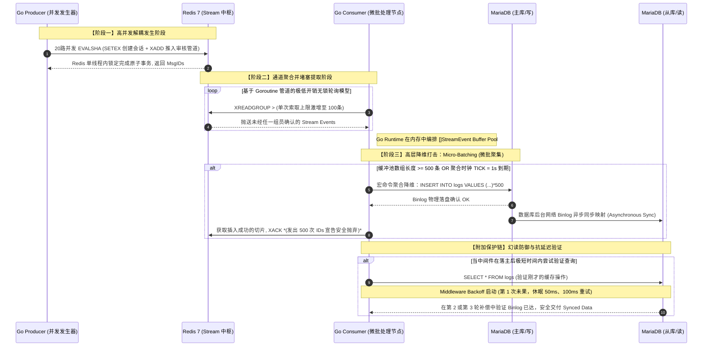

# 分布式高可靠异步消息队列与微批处理架构 (Redis Stream + MySQL)

## 1. 架构定位与业务场景
本架构基于 Go (1.21+) 与 Redis 5.0+ 原生的 Stream 数据结构，并进一步融合了真实的 MariaDB/MySQL 主从复制 (Master/Slave) 集群。构建了一个轻量级、无重度 MQ 依赖（如 Kafka）且具备金融级可靠性的异步消息解耦落盘管道。适用于大促高并发秒杀、微服务中台的大流量并发审计写表等极其严苛的生产场景。

## 2. 核心技术原理深度剖析

### 2.1 高级解耦：EVALSHA 原子性保障与大促写库分离
采用 **Write-Behind (旁路最终一致性)** 架构。生产者利用 Redis 内置 Lua 脚本将 `SETEX` 与 `XADD` 指令进行原子级别的事务硬绑定合并。将原本致命的 MySQL 高并发行级事务持久化动作序列化至轻量级 Redis Stream 管道中彻底解耦。

### 2.2 微批处理压扁并发 (Micro-Batching Buffer Pool)
于消费者端内部构建高性能内存驻留缓冲池 (`Buffer Pool`)。将 `XREADGROUP` 获取的零散消息暂存。通过 `Tick Interval`（默认 1 秒）或定量阀值（目前阈值 500 条）强制触发，在应用底层将数十万散乱的数据凭借强力字符串聚合，压缩转化为极其稀少的底端宏指令（`INSERT INTO table (columns) VALUES (...), (...)...` Bulk SQL）。

### 2.3 异常降级排雷与防爆死信网 (Degradation & Poison Pill DLQ)
若聚合大包裹在提交时抛出 `Duplicate Key` 错误或超长截断数据污染，系统运用了孤立降级降维策略（Batch Degradation）。将宏数据分解回逐个串行的单步插入。再利用 `XPENDING` 从 Redis 深层剥离查找重试超标的“毒丸目标”，不退回原队列而是利用 `XADD` 分流至专属隔离死区 (`DLQ`) 并截断内存水位长度（`Approximate MaxLen` 防爆预防 OOM）。

### 2.4 主从同步延迟的幻读补偿控制 (Replication Lag Compensator)
大促强写带来的 Master/Slave 落盘延迟极易使得前端刚刚生成的数据出现幻读遗失漏洞。在中间件建立 `QueryWithCompensation`。对于发起的延迟型从库查询，自动采用动态指数级自适应退避爬升（Exponential Backoff）在底层网关层面执行自愈探测，确保上层零感知地等到了数据的下探。

---

## 3. 全链路执行时序追踪 (End-to-End Tracing)

为了彻底摸清大促压测机高达近千 QPS 下的并发链路流转全貌，以下是基于上述核心原理串联起来的时序交互链路详细解读：

### 链路交互流解说：
1. **[步骤 1-2]** `Producer` 模拟了极度恶劣的 20 并发流量 DDoS 狂飙攻击。直接使用 `EVALSHA` 将负载交由 Redis，这使得其承载了所有外网的第一波冲击海啸。
2. **[步骤 3-4]** `Consumer` 没有使用传统的逐条挂起阻塞提取。而是开启了多管道多信道的 `XREADGROUP` 批量抓取协程，源源不断将外网的洪峰泄入自己的低成本 Go 内部通讯通道（`chan []StreamEvent`）。
3. **[步骤 5-8]** 这些洪水数据只在 `Consumer` 的内存里面停顿聚堆了最多 `1 秒` 或等到堆积到了 `500` 件的临界点！随后利用底层的宏字符串处理瞬间把 500 个离散的操作通过 **单张网络连接层票据** 给生猛敲进了 `MariaDB` 的引擎里面！使得 DB 的真实 SQL 开销缩减了将近 `500` 倍！
4. **[步骤 9]** 对 Redis 底层进行等量的批量确认 `XACK` 扫尾清空。而由于 `MariaDB` 存在的跨节点网络复制开销引起的滞后可能，我们则在底层查询挂载上了一个自适应轮巡器实现了主仆隔离的数据屏障！

---

## 4. 工程化架构规范结构说明 

本实施库贯彻微服务开发拆解规程以及系统代码层次界限划分：
- `cmd/producer/main.go`：测试产生千万级事件，集结加载底层 Lua 隔离安全特性的发布层应用实体容器入口区。
- `cmd/consumer/main.go`：集成了高性能 Buffer Pool 核心并绑定降级处理、包含 `XAUTOCLAIM` 回收协程与信号保护监控处理单元的微批架构承载核心处理端。
- `internal/dbx/`：对 Maria/MySQL 高频访问进行二次隔离、内置 `QueryWithCompensation` 等级隔离的连接模块。
- `internal/config/`：应用外部状态量提取组件和统一部署注入的中心结构带。
- `internal/redisx/`：融合调度级并发特性隔离，建立断网保护挂起恢复的客户端隔离。
- `internal/logger/`：基于 `slog` 包建立的能够完全兼容全链路云存储监控平台原生态 JSON 格式接口追踪。
