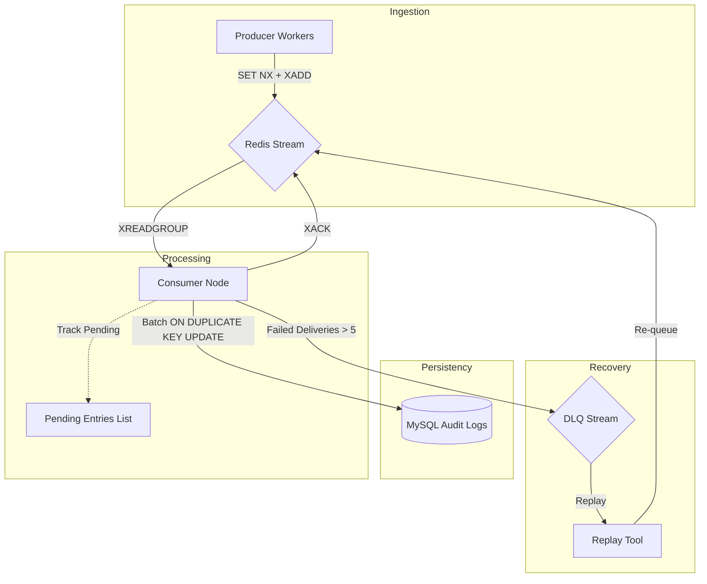

# High-Reliability Redis Stream + MySQL Auditing Pipeline

An elegant, asynchronous, high-concurrency transaction logging and auditing daemon designed for high-availability financial systems. This demo showcases how to achieve **at-least-once delivery** and **eventual consistency** using a lightweight, microservice-friendly infrastructure.

---

## 🚀 Key Reliability Features

> [!TIP]
> This system is built to survive database crashes, network reboots, and consumer node failures without dropping transactional logs.

- ⚡ **Asynchronous Decoupled Writes**: High-throughput transaction loops are never blocked by synchronous MySQL write operations.
- 🛡️ **Atomic Deduplication Ingestion**: Uses a customized Redis Lua script to atomically check transaction idempotency and enqueue messages.
- 🔄 **PEL Crash Reclaiming**: Scans the Pending Entries List (PEL) to recover and claim messages orphaned by consumer node reboots.
- 🧪 **Poison Pill Isolation**: Implements graceful degradation to isolate syntax errors or corrupted event payloads into a dedicated Dead Letter Queue (DLQ).
- 🔁 **Audit Recovery Replay**: Integrates a replay utility to re-inject restored logs back into the queue post-recovery.
- 📊 **Full Telemetry Stack**: Features custom Prometheus exporter servers provisioned with beautifully structured Grafana dashboard interfaces.

---

## 🗺️ Documentation Index

To make onboarding and production management simple, all technical and operations documents have been fully structured and organized:

| Document | Description |
|----------|-------------|
| 📜 **[README.md](file:///f:/redis_mq/README.md)** | Root project overview, reliability features, and directory index. |
| 🏗️ **[System Architecture Guide](file:///f:/redis_mq/docs/architecture.md)** | Deep technical dives covering Lua deduplication, consumer state machines, reclaim loops, and database schemas. |
| 🛠️ **[Operations & Runbook Guide](file:///f:/redis_mq/docs/operation-guide.md)** | Getting started commands, configurations catalog, manual failure injection runbooks, and Prometheus telemetry catalog. |
| 📡 **[OpenAPI 3.1.0 Specification](file:///f:/redis_mq/docs/openapi.yaml)** | Complete design-first YAML specification outlining the Redis MQ Management & Metrics API. |
| 🗄️ **[Original Archived README](file:///f:/redis_mq/docs/archive/README.old.md)** | Original, historical root documentation featuring detailed context and development notes in Chinese. |
| 🗄️ **[Original Archived Architecture](file:///f:/redis_mq/docs/archive/ARCHITECTURE.old.md)** | Original, historical root system architecture overview. |

---

## 🏛️ High-Level Component Flow



---

## 🛠️ Direct Quick Start

### 1. Boot up the local Docker cluster
Spin up the complete broker, replica databases, and time-series monitoring stack:
```powershell
docker-compose up -d
```

### 2. Verify Consumer Processing
Read real-time logs from the consumer instance to verify successful persistence:
```powershell
docker-compose logs -f consumer
```

### 3. Check Audit Logs in MySQL
Access the Master DB and inspect the database audit tables:
```powershell
docker-compose exec mysql-master mysql -u root -proot_pass -D audit_log -e "SELECT * FROM audit_logs LIMIT 10;"
```
