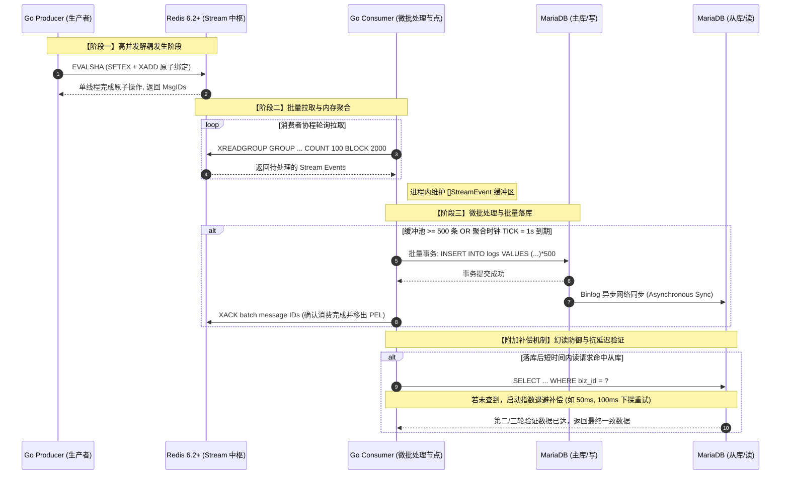

# 基于 Redis Stream 与 MySQL 的高可靠异步落库与微批处理架构设计

## 1. 架构定位与业务场景
本架构基于 Go (1.21+) 与 Redis 6.2+ 原生的 Stream 数据结构，并进一步融合了真实的 MariaDB/MySQL 主从复制 (Master/Slave) 集群。构建了一个轻量级、无重度 MQ 依赖（如 Kafka）且具备较高工程可靠性的异步落库管道。适用于大促高并发秒杀、微服务中台的大流量并发审计写表等最终一致性写入场景。

## 2. 核心技术原理深度剖析

### 2.1 高级解耦：Lua 原子性保障与事件入流
采用 **Write-Behind (旁路最终一致性)** 架构。生产者通过 Lua 脚本将“幂等标记写入”和“事件写入 Stream”封装为单个原子操作，避免在高并发下出现重复投递与状态不一致问题。Redis 通过单线程事件循环保证 Lua 脚本执行期间的原子性，使幂等标记与 Stream 写入在同一执行上下文中完成。

### 2.2 微批处理与批量落库 (Micro-Batching)
消费者使用 Consumer Group 以批量方式拉取消息，并在进程内维护缓冲区，通过条数阈值与时间阈值共同触发批量落库。将大量单条写入摊薄为少量批量事务，显著减少数据库网络往返、连接竞争与事务提交次数，从而提升整体并发吞吐能力。

### 2.3 异常降级与死信隔离 (Degradation & DLQ)
当批量 SQL 失败时（如遇到 Duplicate Key 或脏数据），不直接无限重试整批，而是进入降级路径：按条重放或按更小分片拆分，定位坏消息并隔离到专属死信队列 (DLQ)，其余合法消息继续入库。同时，系统周期性扫描 Pending Entries，对于超过处理超时阈值的消息，使用 `XAUTOCLAIM` 回收并重新投递；若重试次数超过上限，则转入 DLQ，避免毒性消息长期阻塞主消费链路。

### 2.4 数据库端幂等保障 (At-Least-Once 补齐)
由于 Redis Stream 消费在工程上需按 `at-least-once` 语义设计，消费者落库必须具备幂等保障。系统在底层强制依赖业务唯一键与数据库唯一约束（或 `INSERT IGNORE` / `ON DUPLICATE KEY UPDATE`），以彻底消除崩溃重启、Reclaim 重复投递等带来的重复写入风险。

### 2.5 主从同步延迟的补偿控制 (Replication Lag Compensator)
对于“刚写即读从”的场景，中间件提供基于指数退避（Exponential Backoff）的只读补偿查询，以降低主从复制延迟导致的短暂不可见问题。但该机制属于最终一致性增强手段，而非强一致状态保证。

---

## 3. 全链路执行时序追踪

为了清晰展示并发链路运转流程，以下为核心链路交互时序：



### 链路交互说明：
1. **[步骤 1-2]** `Producer` 通过 `EVALSHA` 将负载交由 Redis，原子化落实防重与入流，承载前端瞬时高并发写入。
2. **[步骤 3-4]** `Consumer` 开启 Consumer Group 进行多通道的 `XREADGROUP` 批量抓取，安全稳定地将积压流量引入 Go 内部通信通道。
3. **[步骤 5-8]** 经过内存缓冲区短暂堆积（1秒或满 500 条），将大量零散操作合并为底层宏批量 SQL 插入 MariaDB，摊平 DB 连接与事务开销。
4. **[步骤 9]** 对落库成功的数据，批量提交 `XACK` 从 PEL 移除消息记录。由于主从复制开销产生的毫秒级滞后，采用了自适应补偿器以增强查询端的数据可见性。

---

## 4. 生产级工程规范与项目结构

本方案采用标准 Go 微服务拆解规范，职责隔离明确：

```text
├── cmd/
│   ├── producer/main.go      # 流量产生器，封装 Lua 原子特性与发布限流
│   └── consumer/main.go      # 消费端守卫进程入口，编排各类 Worker
├── internal/
│   ├── consumer/
│   │   ├── group_consumer.go # XREADGROUP 长轮询与分发
│   │   ├── batch_flusher.go  # 内存 Buffer Pool 与微批核心逻辑
│   │   ├── reclaim_worker.go # 扫描 XPENDING 并执行 XAUTOCLAIM 的后台回收作业
│   │   └── dlq_handler.go    # 死信降载隔离与报警触发
│   ├── model/
│   │   ├── event.go          # 统一 Stream Event 数据模型结构
│   │   └── log_record.go     # 与 DB Table 映射的实体层
│   ├── dbx/                  # MySQL 读写分离路由、批量 Insert与退避补偿逻辑
│   ├── redisx/               # Redis 客户端封装、断网恢复挂起、Lua 注册组件
│   └── logger/               # 基于 slog 的原生追踪，结合 trace_id 支撑可观测平台
└── docker-compose.yml        # Redis / MariaDB(主从) 容器化运行基座
```

---

## 5. 生产环境部署建议与约束

为了满足线上实际运行要求，系统后续需补充并明确落实以下要点：

### 5.1 可观测性指标度量
- 设置监控埋点：Stream lag（消息积压延迟差）、Pending 积压数量、Batch flush size（实际刷库批量大小）、DB 响应延迟、降级发生率（Degrade Rate）以及重试与 DLQ 清理计数。

### 5.2 精细化的 Flush 策略控制
- 除了以 500 条 / 1 秒为主要触发条件外，需配置最大批次字节数（防范 MySQL Packet Too Large Error）、单库最大流控阈值，并引入消费端 Backpressure 策略避免 OOM。

### 5.3 消息通道持久化与高可用边界
- 明确 Redis 端 `AOF` 配置（如 `appendfsync everysec`）和主从切换时的潜在数据丢失窗口。确认系统在 Master 宕机时的可容忍范围，通过业务流水号兜底。在内存超标时，引入 `MAXLEN ~ N` 或 `XTRIM` 控制 Stream 无限生长。

### 5.4 DLQ 死信的闭环处理
- 对转入 DLQ 的死信，不能仅停留于数据隔离，必须配套警报规则与人工排查入口（Admin Dashboard），并支持在 Bug 修复后的数据重放修正（Dead Letter Replay Task）并定期清理过期 DLQ。
