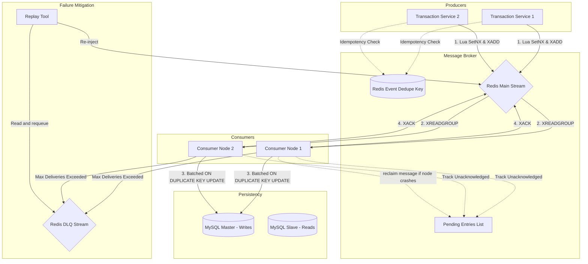

# Redis MQ Audit System Architecture

This document provides a comprehensive technical overview of the Redis Stream-based message queue system developed for high-concurrency log auditing. The core philosophy of this architecture is **at-least-once delivery** paired with downstream **idempotence (eventual consistency)**, prioritizing isolation and recovery over synchronous blocking writes.

---

## 1. High-Level Architectural Flow

The auditing pipeline decouples the primary high-concurrency transaction services (Producers) from the persistent audit database (MySQL). It manages sudden transactional traffic spikes and isolates database service interruptions.



---

## 2. Ingestion & Idempotent Production

To prevent duplicate logs from flooding the message broker due to client-side network retries, the system utilizes a **design-first producer deduplication check**.

### Atomic Lua Production
The producer leverages an atomic Lua script executed in a single transaction in Redis. This prevents race conditions where dual threads attempt to publish the same transaction log simultaneously.

```lua
-- KEYS[1] = dedupe key ("dedupe:event:<id>")
-- KEYS[2] = stream name ("event_queue")
-- ARGV[1] = event_id, ARGV[2] = TTL in seconds, ARGV[3] = session_id, ARGV[4] = payload, ARGV[5] = produced_at

local inserted = redis.call('SET', KEYS[1], ARGV[1], 'NX', 'EX', ARGV[2])
if not inserted then
    return '' -- Suppressed duplicate
end

return redis.call('XADD', KEYS[2], '*', 
    'event_id', ARGV[1], 
    'session_id', ARGV[3], 
    'payload', ARGV[4], 
    'produced_at', ARGV[5]
)
```

```
[Producer Client] 
       │
       ▼
 [Run Lua Script] ─────► [SET dedupe:event:123 NX EX 300]
       │                                │
       │ (Key already exists)           │ (Key created successfully)
       ├── Suppressed Duplicate         └──► [XADD event_queue * event_id 123...]
       ▼                                                 │
(Return empty)                                           ▼
                                                (Return Stream ID: 171630-0)
```

---

## 3. Persistent Consumer & Acknowledgment Strategy

The consumer service is structured around a **strict ACK workflow**: a message is never removed from the tracking cache (`XACK`) until it has been reliably persisted or safely isolated.

### Consumer State Machine
```
            +------------------------+
            |      XREADGROUP        |
            +------------+-----------+
                         |
                         ▼
            +------------------------+
            |   Push to Event Buf    |
            +------------+-----------+
                         |
      [Flush Interval / Max Batch Reached]
                         |
                         ▼
            +------------------------+
            |   MySQL UpsertBatch    |
            +------------+-----------+
              /                    \
    (Success)/                      \(Failed)
            /                        \
+---------------------+     +--------------------------+
|  Batch XACK         |     | Graceful Degradation:    |
|  (Clean up PEL)     |     | Handle Single-by-Single  |
+---------------------+     +------------+-------------+
                                         |
                                         ▼
                             +------------------------+
                             |   MySQL Single Upsert  |
                             +----+--------------+----+
                                 /                \
                       (Success)/                  \(Failure)
                               /                    \
                   +-------------------+    +------------------------+
                   | Single XACK       |    | Check Delivery Counter |
                   +-------------------+    +-----------+------------+
                                                        |
                                            [delivery_count > max]
                                                        |
                                                        ▼
                                            +------------------------+
                                            |  Route to DLQ & XACK   |
                                            +------------------------+
```

### Graceful Degradation
To keep bad payloads ("poison pills") from stalling the batch consumption pipeline, the consumer operates in **dual-processing mode**:
1. **Batch Mode**: Flushes up to `BATCH_SIZE` events in a single MySQL statement to maximize write throughput.
2. **Single Mode**: If a batch flush fails (due to database lockouts, syntax errors, or payload corruptions), the consumer degrades immediately, trying to insert each message individually. This identifies and isolates bad payloads while letting valid logs execute cleanly.

---

## 4. Crash Recovery: PEL & Reclaiming

If a consumer node goes offline (crashes, system reboot, network partitioning) after acquiring messages but before writing to MySQL and invoking `XACK`, the messages remain listed in Redis's **Pending Entries List (PEL)**.

### Reclaim Loop Execution
Every `RECLAIM_INTERVAL` (e.g. 5s), active consumers scan the PEL using the `XPENDING` command:
1. Identify messages that have been in an unacknowledged/idle state for more than the `RECLAIM_MIN_IDLE` threshold (e.g. 10s).
2. The active consumer invokes `XCLAIM` to take ownership of these messages, resetting their idle timer and updating the consumer name.
3. The active consumer processes the reclaimed messages and flushes them to MySQL.

```
[PEL Scan] ──► XPENDING event_queue processor_group - + 100
                    │
                    ▼  (Filters messages with idle time > 10s)
               Reclaim Message ID: 1716301292000-0
                    │
                    ▼
               XCLAIM event_queue processor_group consumer-node-2 10000 1716301292000-0
                    │
                    ▼  (Consumer Node 2 takes ownership, increments retry count)
               Persist to MySQL ──► XACK event_queue processor_group 1716301292000-0
```

---

## 5. Dead Letter Queue (DLQ) & Manual Replay

When a message is continually reclaimed or fails database insertions repeatedly, its delivery count increments. Once this count surpasses `MAX_DELIVERIES` (default: `5`), it is classified as a permanently failed event.

### DLQ Ingestion & Isolation
To prevent processing loops from consuming system capacity, the consumer routes the failed message to a dedicated Redis Stream: `event_queue_dlq`. The entry is packed with:
- The original log payload
- The transaction metadata (`event_id`, `session_id`, `produced_at`)
- Contextual failure logs (`reason_code`, `reason`, `retry_count`, `failed_at`)

Once safely appended to the DLQ, the consumer acknowledges (`XACK`) the primary stream message, unblocking the main log pipeline.

### Manual Replay Loop
After infrastructure restoration or codebase bug fixes, administrators execute the `replaydlq` tool:
1. It reads messages from `event_queue_dlq` using `XRANGE`.
2. Re-serializes the original event payload and appends special audit metadata (`replayed_from_dlq=true`, `dlq_id=<original_id>`).
3. Enqueues the event back into the primary stream (`event_queue`).
4. Unless `DLQ_REPLAY_KEEP_SOURCE=true` is set, successfully re-queued entries are deleted (`XDEL`) from the DLQ.

---

## 6. MySQL Idempotent Database Schema

At-least-once MQ systems shift deduplication responsibilities downstream. Since network failures can trigger duplicate deliveries, the database layer must absorb repeated records without duplicate errors or row corruption.

### Relational Table Spec
The database schema utilizes an event identifier index and upsert strategies to guarantee idempotence.

```sql
CREATE TABLE IF NOT EXISTS audit_logs (
    event_id VARCHAR(100) PRIMARY KEY,
    stream_id VARCHAR(100) NOT NULL,
    session_id VARCHAR(100) NOT NULL,
    payload TEXT NOT NULL,
    produced_at TIMESTAMP NOT NULL,
    created_at TIMESTAMP DEFAULT CURRENT_TIMESTAMP,
    updated_at TIMESTAMP DEFAULT CURRENT_TIMESTAMP ON UPDATE CURRENT_TIMESTAMP,
    KEY idx_audit_logs_session_id (session_id),
    KEY idx_audit_logs_created_at (created_at)
);
```

### Idempotent Upsert Logic
All consumer writes use the `ON DUPLICATE KEY UPDATE` syntax. If an `event_id` already exists in the database, the record is safely updated with the latest details and marked with an updated timestamp instead of throwing a constraint exception.

```sql
INSERT INTO audit_logs (event_id, stream_id, session_id, payload, produced_at) 
VALUES (?, ?, ?, ?, ?)
ON DUPLICATE KEY UPDATE
    stream_id = VALUES(stream_id),
    session_id = VALUES(session_id),
    payload = VALUES(payload),
    produced_at = VALUES(produced_at),
    updated_at = CURRENT_TIMESTAMP;
```
