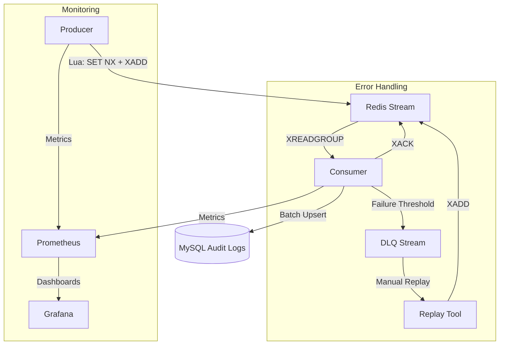

# System Architecture - Redis MQ Audit System

This document describes the high-level architecture of the Redis-based Message Queue system designed for reliable financial log auditing.

## Overview

The system provides a reliable, asynchronous pipeline for persisting audit logs from high-concurrency transaction services into a MySQL database. It prioritizes **at-least-once delivery** and **eventual consistency** using Redis Streams as the core message broker.

## Components

### 1. Producer
- **Atomic Operations**: Uses a Lua script to perform an idempotency check (SET NX) and message submission (XADD) in a single atomic step.
- **Deduplication**: Prevents duplicate messages from entering the stream if the producer retries due to network issues.
- **Metrics**: Records production rates and latency.

### 2. Redis Stream (Message Broker)
- **Main Stream**: The primary buffer for incoming audit events.
- **Consumer Group**: Manages message distribution among multiple consumer instances.
- **Pending Entries List (PEL)**: Tracks messages that have been delivered but not yet acknowledged.

### 3. Consumer Service
- **Batch Processing**: Groups messages into batches to optimize MySQL write throughput.
- **Graceful Degradation**: If a batch write fails, the consumer automatically degrades to single-message processing to isolate problematic events.
- **Acknowledge (ACK) Strategy**: Messages are only acknowledged (`XACK`) AFTER successful persistence in MySQL or successful routing to the DLQ.
- **Message Reclaiming**: Periodically scans the PEL for timed-out messages and re-claims them for processing, ensuring no messages are lost if a consumer instance crashes.

### 4. Dead Letter Queue (DLQ)
- **DLQ Stream**: A separate Redis Stream for messages that consistently fail processing.
- **Failure Analysis**: Stores original event data along with failure reasons and retry counts for easier debugging.

### 5. Replay Tool
- **Recovery Loop**: A dedicated utility to read messages from the DLQ and re-inject them into the Main Stream after manual intervention or system fixes.

### 6. MySQL Audit Store
- **Idempotent Persistence**: Uses `INSERT ... ON DUPLICATE KEY UPDATE` to ensure that duplicate deliveries (common in at-least-once systems) do not result in duplicate records.

## Data Flow

## Reliability Features

| Feature | Implementation |
|---------|----------------|
| **No Loss** | Consumer only ACKs after persistence; PEL reclaiming handles crashes. |
| **Deduplication** | Producer-side Lua check and MySQL-side Upsert logic. |
| **Throughput** | Configurable batch sizes and flush intervals. |
| **Isolation** | DLQ prevents "poison pills" from blocking the main pipeline. |
